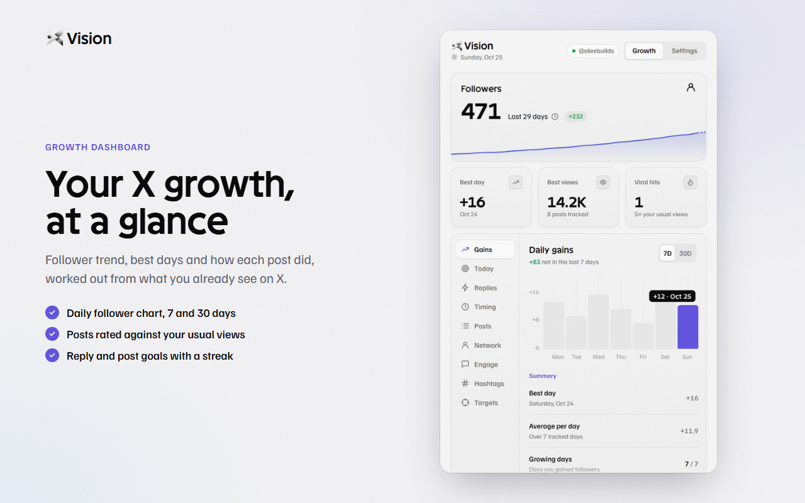

# XVision

**Growth insights for X, right in your browser.**

XVision is a free Chrome extension that adds follower counts, reach signals, the best time to post and a calmer feed to X (x.com). Everything is worked out from what X already shows you, and stays in your browser.

**Demo page:** https://kakahaja07.github.io/xvision/ · [Guides](https://kakahaja07.github.io/xvision/guides/) · [Free tools](https://kakahaja07.github.io/xvision/tools/)

## Features

- **Growth dashboard:** daily follower chart (7 and 30 days), best days, and your posts rated against your usual views
- **Signal ring:** a small ring next to every name; hover it for followers, follow-back ratio, account age and post reach
- **Reply early:** fresh posts from bigger accounts that still have few replies, plus a reply queue in the popup
- **Calmer feed:** collapse engagement bait, templated posts, crypto spam and sensitive media; add your own muted words
- **Best time to post:** the hours and hashtags that reach furthest in your own feed
- **Network and engagement:** who doesn't follow back, and who you reply to that never replies
- **Private notes:** tag people and keep notes, shown next to their name

## Install

1. Download [`downloads/xvision-1.0.0.zip`](downloads/xvision-1.0.0.zip) and unzip it, or clone this repo.
2. Open `chrome://extensions` and turn on **Developer mode** (top right).
3. Click **Load unpacked** and choose the unzipped folder (or the [`extension`](extension) folder of this repo).
4. Open x.com and pin XVision to your toolbar.

## Privacy

- Runs only on `x.com` and `twitter.com`
- No account, no sign-in, no servers, and no network requests of its own
- All data stays in your browser's local storage
- Never posts, likes, follows or replies for you

Full details: [privacy policy](privacy-policy.html).

## What's in this repo

| Path | What it is |
|---|---|
| `extension/` | The ready-to-load Chrome extension |
| `downloads/` | The same extension as a zip |
| `index.html` | The demo page |
| `guides/` | Growth guides for X |
| `tools/` | Free tools: X video downloader, thread maker, post length checker, engagement rate calculator |
| `worker/` | The free Cloudflare Worker behind the video downloader, with [setup steps](worker/README.md) |
| `privacy-policy.html` | Privacy policy |
| `assets/` | Images and fonts for the demo page |

## Credits

Built by Prashant Sharma. Inspired by [XRay](https://github.com/fayazara/xray) by fayazara.

XVision is an independent project and is not affiliated with, endorsed by, or sponsored by X Corp.
